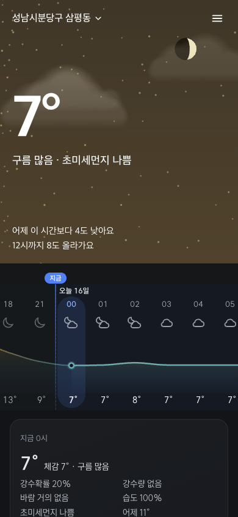
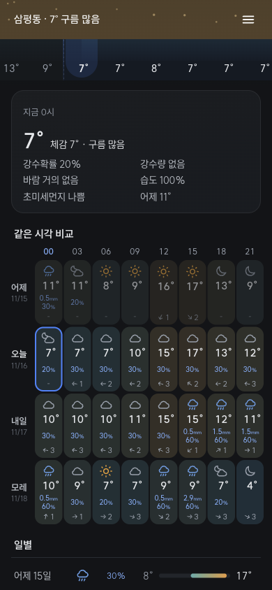
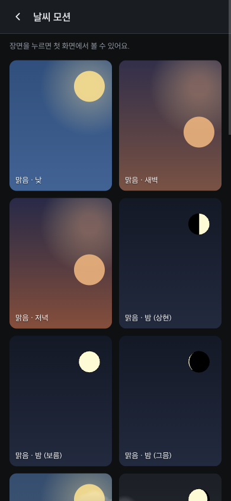
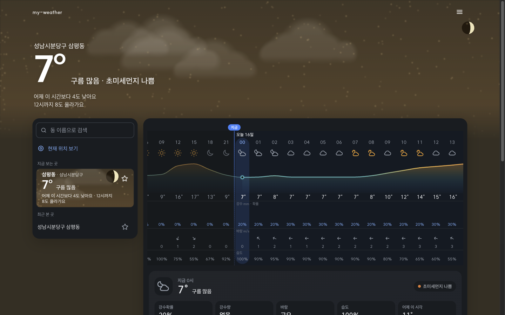
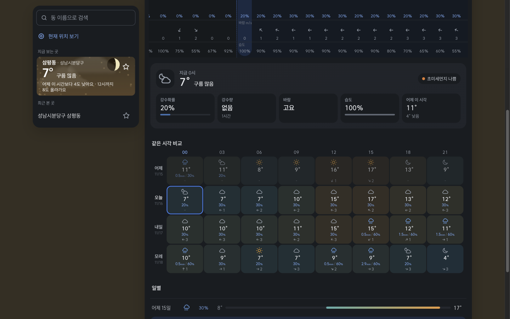

# my-weather

어제부터 예보 끝까지 한 줄로 보는 날씨. 지금 날씨에 맞춘 배경 모션 위에 시간별 그래프, 같은 시각 비교, 일별 요약을 보여 주는 개인용 날씨 웹앱(PWA)입니다. 기상청 단기예보를 직접 모으고, 지난 관측값을 쌓아 두었다가 "어제 이 시간"과 비교해 줍니다.

<p>
  
  
  
</p>



## 기능

- **시간별 그래프**: 어제 00시부터 예보 끝(최대 4~5일 뒤)까지 한 줄. 지금 근처는 1시간, 나머지는 3시간 칸. 기온 곡선은 기온에 따라 색이 바뀌고, 강수량·강수확률·바람·습도 줄이 함께 나옵니다.
- **지난 기록**: 초단기실황을 매시간 저장해서, 기상청이 하루만 보관하는 관측값도 어제까지 이어서 보여 줍니다.
- **같은 시각 비교**: 어제·오늘·내일·모레를 00~21시(3시간 간격) 한 표로. 칸마다 날씨, 기온, 강수량/강수확률, 풍속.
- **날씨 모션**: 지금 날씨와 시간대에 맞춘 배경. 해·달(위상), 구름, 비·눈(세기와 바람 방향), 천둥번개, 안개, 황사. 메뉴의 "날씨 모션"에서 26개 장면을 미리 볼 수 있습니다. 움직임 줄이기 설정이면 멈춘 한 장면만 그립니다.
- **미세먼지·안개**: 가까운 측정소의 미세먼지 등급(에어코리아), 가까운 관측소의 시정으로 판단한 안개(기상청 API허브).
- **장소**: 행정동 이름 검색, 현재 위치. 즐겨찾기한 장소는 서버가 정기적으로 모읍니다.
- **로그인과 알림**: 패스키(Face ID·지문) 로그인. 사람마다 자기 즐겨찾기. 웹 푸시로 "곧 비"(1~3시간 안에 비·눈 시작)와 "전날 밤"(22시, 내일 비 예보) 알림.
- **PWA**: 홈 화면에 추가해서 앱처럼 쓰고, 연결이 끊기면 마지막으로 받은 날씨를 보여 줍니다.
- **PC 화면**: 위쪽 하늘 모션, 왼쪽 장소 목록, 오른쪽 그래프·상세 카드·비교 표.



## 구성

| | |
|---|---|
| 서버 | Go 1.26 단일 바이너리. 수집기 + HTTP API + 알림. SQLite(순수 Go 드라이버) |
| 웹 | SvelteKit(Svelte 5, adapter-static) PWA. 빌드 결과를 Go 바이너리에 넣어서 함께 서비스 |
| 데이터 | 기상청 단기예보 조회서비스(초단기실황·초단기예보·단기예보), 에어코리아 대기오염정보, 기상청 API허브(AWS 시정) |

```
cmd/myweather/     실행 파일 (migrate, serve, enroll-token, vapid-keygen, backup)
internal/
  collector/       기상청 정기 수집 + 처음 보는 격자 즉시 조회
  timeline/        칸 나누기, 출처 고르기, 3시간 집계, 체감온도, 요약, 일별
  httpapi/         공개 API, 즐겨찾기·설정 API, 레이트 리밋
  auth/ push/      패스키(WebAuthn), 웹 푸시(VAPID)
  air/ fog/        미세먼지, 안개
  grid/            행정동 → 기상청 격자 표, 검색
  store/           SQLite 저장소와 마이그레이션
  webui/           웹 빌드 결과를 embed로 서비스
web/               SvelteKit 앱
```

## 실행

### 준비물

- Go 1.26, Node.js 22 이상
- [공공데이터포털](https://www.data.go.kr) 인증키(인코딩 값). 아래 서비스를 활용신청해 둡니다.
  - 기상청_단기예보 조회서비스 (필수)
  - 한국환경공단_에어코리아_대기오염정보, 측정소정보 (미세먼지. 없으면 미세먼지 없이 동작)
- [기상청 API허브](https://apihub.kma.go.kr) 인증키 (선택. 없으면 안개 없이 동작)

저장소 루트에 `.env`를 만듭니다(git에 올라가지 않습니다).

```
api_key = <공공데이터포털 인증키(인코딩)>
apihub_key = <API허브 인증키>
```

### 빌드와 실행

```bash
cd web && npm ci && npm run build && cd ..   # web/build → internal/webui/dist
go build -o myweather ./cmd/myweather
./myweather serve                            # DB 마이그레이션 후 수집기와 http://127.0.0.1:8080 시작
```

DB는 기본으로 `./var/myweather.sqlite3`에 생깁니다. 수집할 격자는 `MYWEATHER_GRIDS`(`nx,ny;nx,ny`)로 정합니다. 그 밖의 장소는 처음 열 때 즉시 조회합니다.

### 웹만 개발할 때

```bash
cd web
echo 'MW_API=http://127.0.0.1:8080' > .env.local   # /api를 넘길 서버
npm run dev
```

### 로그인·알림 켜기

패스키와 웹 푸시는 HTTPS 주소가 있어야 합니다.

```bash
./myweather vapid-keygen --out vapid.env           # 푸시 키(한 번만 만들고 보관)
MYWEATHER_RP_ID=weather.example.com \
MYWEATHER_VAPID_FILE=vapid.env \
./myweather serve
./myweather enroll-token                           # 첫 기기 등록 코드(10분, 1회용)
```

앱 메뉴 → 맨 아래 "정보" 칸을 빠르게 세 번 누르면 등록 화면이 나옵니다. 리버스 프록시 뒤에 둘 때는 `MYWEATHER_TRUSTED_PROXIES`에 프록시 대역을 넣어야 레이트 리밋이 실제 접속 IP 기준으로 동작합니다. 전체 환경변수는 `./myweather help`로 볼 수 있습니다.

### 테스트

```bash
go test ./...
cd web && npm run check
```

## 출처

- 날씨: 기상청 단기예보 조회서비스(공공데이터포털), 기상청 API허브
- 미세먼지: 한국환경공단 에어코리아
- 글꼴: [SUIT](https://sun.fo/suit/) (SIL Open Font License 1.1, `web/static/fonts/SUIT-LICENSE.txt`)

## 라이선스

코드는 [MIT](LICENSE). 글꼴(SUIT)은 OFL 1.1을 따릅니다.
